# ₿ BTC Cycle Trader — EUR Quantitative & Spanish IRPF Paper Trading Engine

[🇬🇧 English](#-english-documentation) · [🇪🇸 Español](#-documentación-en-español)

<p align="center">


</p>

<a id="-english-documentation"></a>

## 🇬🇧 English Documentation

### 🎯 Executive Overview

BTC Cycle Trader is a self-hosted quantitative Bitcoin accumulation and cycle-timing **paper-trading** system. It combines hourly market data, stationary features, a four-state Hidden Markov Model (HMM), LightGBM inference, deterministic FIFO accounting, and a bilingual FastAPI dashboard. Portfolio reporting is strictly in **Euros (€)** and **BTC / Net BTC Equivalent**. Taxable disposals model Spanish IRPF *Base del Ahorro* progression, annual EUR realized gains/losses, FIFO cost basis, and ring-fenced `tax_escrow_eur`. It does not place live orders.

### ⚖️ Strategy Profiles

| Dimension | Profile A — Passive DCA Holder | Profile B — Active Cycle-ML Trader |
| --- | --- | --- |
| Execution | Scheduled/manual contributions buy BTC immediately. | Contributions enter cash first; signals and persisted allocation govern deployment/rebalancing. |
| Fees | `0.10%` execution fee included in acquisition cost/FIFO lots. | `0.10%` fee applies to BTC trades and FIFO basis. |
| Cash yield | No cash-yield strategy for passive BTC. | Spendable USDT cash earns configurable `RISK_FREE_APY` (`2.5% TAE` default); tax escrow excluded. |
| Signal zones | No active signal allocation. | `<30%`: preserve cash; `30%–<60%`: Smart DCA / retain scheduled cash; `>=60%`: full deployment. Display zones do not override allocator hysteresis. |
| Cooldown | Not applicable to passive contributions. | Rebalances observe a `168h` cooldown. |
| Distribution guard | No active cycle distribution. | Below 30%, price must be at least `15%` above weighted FIFO cost to distribute toward the `20%` BTC floor; never targets below 20% BTC. |

### 🏗️ System Architecture

```mermaid
flowchart LR
    A["Binance EUR Market Feed<br/>ccxt public endpoints"] --> B["Parquet<br/>Polars · DuckDB"]
    B --> C["Feature Engineering<br/>UTC · completed daily joins"]
    C --> D["4-State HMM<br/>Regime probabilities"]
    D --> E["LightGBM<br/>p(+10% / 30d) · SHAP X-Ray"]
    E --> F["EUR FIFO Tax Engine<br/>IRPF 19%–30% · escrow"]
    F --> G["SQLite Ledger<br/>Trades · lots · online backups"]
    G --> H["FastAPI REST API<br/>Canonical payloads"]
    H --> I["Bilingual Dashboard<br/>CET/CEST · Dark/Light themes"]
```



### 🧾 Spanish Fiscal Engine — IRPF *Base del Ahorro*

Annual net realized gains are accounted in EUR; FIFO consumes oldest lots first, and same-year losses may offset gains.

| Annual taxable savings base | Marginal rate |
| --- | ---: |
| Up to €6,000 | 19% |
| €6,000–€50,000 | 21% |
| €50,000–€200,000 | 23% |
| €200,000–€300,000 | 27% |
| €300,000–€500,000 | 28% |
| Above €500,000 | 30% |

Accrued liabilities remain ring-fenced in `tax_escrow_eur`, cannot be reinvested, and are excluded from spendable cash. Verify applicable rules with a qualified Spanish tax professional.

### ✨ Dashboard Highlights

- 🕒 **Spain local time:** `Europe/Madrid`, automatic `CET` / `CEST`; stored/API timestamps remain UTC.
- 🎨 **Dual themes:** `Cyber-Emerald` dark and `Nordic-Daylight` light, with instant `ES | EN` toggle.
- 🔍 **Live ML Signal X-Ray:** `Radiografía de la señal` / “Why?” popover with probability gauge, 30%/60% markers, distance to next zone, and five feature attributions with signed percentage-point (`pp`) impacts; explanatory, not causal.
- 📅 **Recurring DCA planner:** weekly Monday–Sunday or monthly days `1–31` with month-end clamping; manual capital injection (`+ Añadir capital`).
- 🧾 **Tax tools:** live IRPF/FIFO breakdown, UTF-8 CSV export, and read-only liquidity withdrawal What-If simulator.

### 🚀 Quickstart

Requirements: Docker Engine and Docker Compose. Public market endpoints need no exchange trading credentials.

```bash
docker compose up -d --build
```

Open <http://localhost:8501>. With Python 3.11+ and `requirements.txt` installed:

```bash
pytest -q
node --check web/app.js && node --check web/i18n.js
```

### 🗂️ Project Structure

`src/` contains FastAPI, backtests, execution, features, ingestion, models, and operations; `web/` contains the bilingual HTML/CSS/JavaScript Plotly dashboard; `tests/` contains unit, API, tax, leakage, and frontend-contract tests; `docs/adr/` contains accepted architecture decisions. Runtime `data/` and `models/` artifacts are Git-ignored.

### 📚 Architecture Decision Records

ADR aceptados: [0001](docs/adr/0001-onchain-data-staleness-and-source-migration.md) · [0002](docs/adr/0002-profile-b-hysteresis-allocation-floor-and-yield.md) · [0003](docs/adr/0003-fifo-capital-gains-tax-accounting.md) · [0004](docs/adr/0004-recurring-dca-backtest-and-dashboard-diagnostics.md) · [0005](docs/adr/0005-tax-aware-asymmetric-rebalancing.md) · [0006](docs/adr/0006-spanish-irpf-progressive-tax-and-multicurrency-btc-kpi.md) · [0007](docs/adr/0007-bilingual-i18n-dashboard-es-en.md) · [0008](docs/adr/0008-automated-monthly-retraining-and-sqlite-backup.md) · [0009](docs/adr/0009-eur-native-valuation-and-display.md) · [0010](docs/adr/0010-configurable-recurring-dca-schedule.md) · [0011](docs/adr/0011-tax-reporting-and-withdrawal-simulation.md) · [0012](docs/adr/0012-live-signal-explainability.md) · [0013](docs/adr/0013-month-end-clamped-monthly-dca.md)

### ⚠️ Responsible Use, License & Disclaimer

Experimental paper-trading and research software, not financial, investment, or tax advice. It makes no guarantees about data, tax treatment, model quality, or returns. Validate tax assumptions with a professional. Do not configure order-execution credentials without reviewing security and operations.

The requested MIT badge is shown, but this repository currently has no tracked `LICENSE` file. The badge is not legal text; add and review a license before relying on or redistributing this project under MIT terms.

---

<a id="-documentación-en-español"></a>

## 🇪🇸 Documentación en Español

### 🎯 Resumen Ejecutivo

BTC Cycle Trader es un sistema cuantitativo autoalojado de acumulación de Bitcoin y sincronización con ciclos para **paper trading**. Combina datos horarios, variables estacionarias, un Modelo Oculto de Markov (HMM) de cuatro estados, inferencia LightGBM, contabilidad FIFO determinista y un panel FastAPI bilingüe. La cartera se expresa estrictamente en **euros (€)** y **BTC / Equivalente BTC Neto**. Las ventas imponibles modelan el IRPF progresivo español de la *Base del Ahorro*, ganancias/pérdidas realizadas anuales en EUR, coste FIFO y `tax_escrow_eur` segregado. No ejecuta órdenes reales.

### ⚖️ Perfiles de Estrategia

| Dimensión | Perfil A — DCA Pasivo | Perfil B — Trader Cycle-ML Activo |
| --- | --- | --- |
| Ejecución | Las aportaciones programadas/manuales compran BTC de inmediato. | Los fondos entran primero en efectivo; señales y asignación persistida controlan inversión y rebalanceo. |
| Comisiones | La comisión `0,10%` se incorpora al coste de adquisición/lote FIFO. | La comisión `0,10%` se aplica a operaciones BTC y coste FIFO. |
| Rendimiento del efectivo | Sin estrategia de rendimiento para la posición pasiva BTC. | El efectivo USDT disponible genera `RISK_FREE_APY` configurable (`2,5% TAE` por defecto); excluye escrow fiscal. |
| Zonas de señal | Sin asignación activa por señal. | `<30%`: preservar efectivo; `30%–<60%`: DCA inteligente / mantener efectivo programado; `>=60%`: inversión total. Las zonas visuales no sustituyen la histéresis del asignador. |
| Periodo de espera | No aplicable a aportaciones pasivas. | Los rebalanceos respetan un periodo de `168h`. |
| Protección de distribución | Sin distribución activa por ciclo. | Por debajo del 30%, el precio debe superar al menos un `15%` el coste FIFO ponderado para reducir hacia el suelo del `20%` en BTC; nunca apunta a menos del 20%. |

### 🏗️ Arquitectura del Sistema

```mermaid
flowchart LR
    A["Feed de mercado Binance EUR<br/>endpoints públicos ccxt"] --> B["Parquet<br/>Polars · DuckDB"]
    B --> C["Ingeniería de variables<br/>UTC · joins diarios completos"]
    C --> D["HMM de 4 estados<br/>Probabilidades de régimen"]
    D --> E["LightGBM<br/>p(+10% / 30d) · Radiografía SHAP"]
    E --> F["Motor fiscal FIFO EUR<br/>IRPF 19%–30% · escrow"]
    F --> G["Libro SQLite<br/>Operaciones · lotes · backups online"]
    G --> H["API REST FastAPI<br/>Payloads canónicos"]
    H --> I["Panel bilingüe<br/>CET/CEST · temas oscuro/claro"]
```



### 🧾 Motor Fiscal Español — IRPF *Base del Ahorro*

Las ganancias netas se contabilizan en EUR por año, se consumen primero los lotes FIFO más antiguos y las pérdidas del mismo año pueden compensar ganancias.

| Base imponible anual del ahorro | Tipo marginal |
| --- | ---: |
| Hasta €6.000 | 19% |
| €6.000–€50.000 | 21% |
| €50.000–€200.000 | 23% |
| €200.000–€300.000 | 27% |
| €300.000–€500.000 | 28% |
| Más de €500.000 | 30% |

Las obligaciones acumuladas permanecen segregadas en `tax_escrow_eur`, no se reinvierten y se excluyen del efectivo disponible. Verifica las reglas con un profesional fiscal español cualificado.

### ✨ Funciones Destacadas del Panel

- 🕒 **Hora local española:** `Europe/Madrid`, cambios automáticos `CET` / `CEST`; las marcas almacenadas y de API permanecen en UTC.
- 🎨 **Dos temas:** `Cyber-Emerald` oscuro y `Nordic-Daylight` claro, con selector instantáneo `ES | EN`.
- 🔍 **Radiografía ML en vivo:** gauge de probabilidad, marcas 30%/60%, distancia a la siguiente zona y cinco atribuciones con impactos firmados en puntos porcentuales (`pp`); explicativas, no causales.
- 📅 **Planificador DCA recurrente:** semanal de lunes a domingo o mensual días `1–31`, con ajuste automático a fin de mes; incluye inyección manual (`+ Añadir capital`).
- 🧾 **Herramientas fiscales:** desglose IRPF/FIFO en vivo, exportación CSV UTF-8 y simulador de retiros What-If de solo lectura.

### 🚀 Inicio Rápido

Requisitos: Docker Engine y Docker Compose. Los endpoints públicos no requieren credenciales de trading del exchange.

```bash
docker compose up -d --build
```

Abre <http://localhost:8501>. Con Python 3.11+ y `requirements.txt` instalados:

```bash
pytest -q
node --check web/app.js && node --check web/i18n.js
```

### 🗂️ Estructura del Proyecto

`src/` contiene FastAPI, backtests, ejecución, variables, ingesta, modelos y operaciones; `web/` contiene el panel bilingüe HTML/CSS/JavaScript Plotly; `tests/` contiene pruebas unitarias, API, fiscalidad, leakage y frontend; `docs/adr/` contiene decisiones aceptadas. Los datos y modelos runtime se ignoran en Git.

### 📚 Registros de Decisiones de Arquitectura

ADR aceptados: [0001](docs/adr/0001-onchain-data-staleness-and-source-migration.md) · [0002](docs/adr/0002-profile-b-hysteresis-allocation-floor-and-yield.md) · [0003](docs/adr/0003-fifo-capital-gains-tax-accounting.md) · [0004](docs/adr/0004-recurring-dca-backtest-and-dashboard-diagnostics.md) · [0005](docs/adr/0005-tax-aware-asymmetric-rebalancing.md) · [0006](docs/adr/0006-spanish-irpf-progressive-tax-and-multicurrency-btc-kpi.md) · [0007](docs/adr/0007-bilingual-i18n-dashboard-es-en.md) · [0008](docs/adr/0008-automated-monthly-retraining-and-sqlite-backup.md) · [0009](docs/adr/0009-eur-native-valuation-and-display.md) · [0010](docs/adr/0010-configurable-recurring-dca-schedule.md) · [0011](docs/adr/0011-tax-reporting-and-withdrawal-simulation.md) · [0012](docs/adr/0012-live-signal-explainability.md) · [0013](docs/adr/0013-month-end-clamped-monthly-dca.md)

### ⚠️ Uso Responsable, Licencia y Descargo de Responsabilidad

Software experimental de paper trading e investigación; no es asesoramiento financiero, de inversión ni fiscal. No garantiza datos, tratamiento tributario, calidad del modelo ni rendimientos. Verifica los supuestos fiscales con un profesional. No configures credenciales de ejecución sin revisar la seguridad y las operaciones.

Se muestra la insignia MIT solicitada, pero el repositorio no tiene un archivo `LICENSE` versionado. La insignia no es texto legal; añade y revisa una licencia antes de confiar en términos MIT o redistribuir el proyecto bajo ellos.
